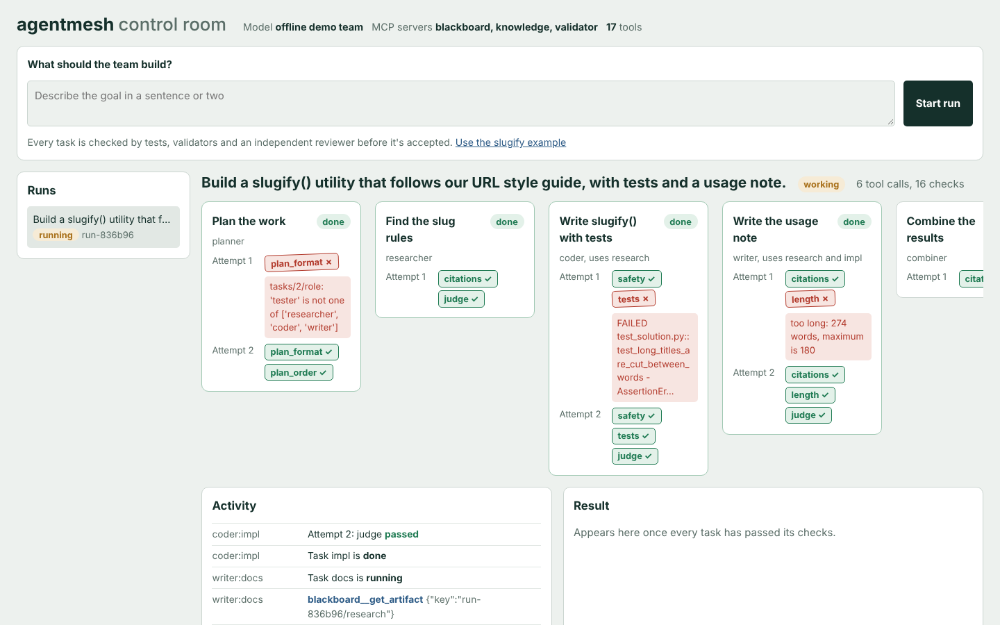
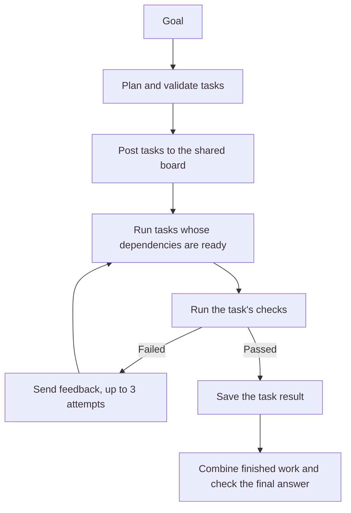

# AgentMesh: Multi-Agent System

A Python project that coordinates AI agents to complete writing and small coding tasks. It plans the work, checks the results, and sends failed checks back as feedback so the agents can try again.

The agents share a task board, a validator, and a document library through **MCP (Model Context Protocol)**. You can run the project from the terminal or follow its progress in a web dashboard.

**Built with:** Python, FastAPI, the MCP SDK, and a plain HTML/CSS/JavaScript dashboard.



## What it does

- Splits a goal into tasks and runs independent tasks together.
- Checks work using word counts, JSON validation, citation checks, Python safety checks, pytest, and AI review, depending on the task.
- Retries failed work with specific feedback, up to three attempts by default.
- Supports Groq, Claude, and a scripted offline demo that needs no API key.
- Shows task status, check results, model waits, and errors in the dashboard.
- Runs scheduled jobs defined in YAML, such as a document audit and a failed-task report.

| Example goal | Expected workflow |
|---|---|
| "Write a paragraph about renewable energy." | One writer with length and quality checks; citations are optional. |
| "Summarize our URL style guide with sources." | Read relevant local documents and check citations. |
| "Build a slugify() utility that follows our URL style guide, with tests and a usage note." | Research, code, tests, and documentation, with dependencies between tasks. |

## Quick start: no API key needed

Use **Python 3.12** for the tested setup. You also need Git to clone the repository. Node.js is optional and is used only for the dashboard tests.

### Windows PowerShell

```powershell
git clone https://github.com/Sanskar3584/MultiAgent-System.git
cd MultiAgent-System

python -m venv .venv
.\.venv\Scripts\python.exe -m pip install -r requirements.txt

$env:AGENTMESH_PROVIDER = "offline"
.\.venv\Scripts\python.exe main.py demo
```

The demo deliberately produces a bad plan, a failing code test, and an overly long note. You should see each failure followed by a corrected attempt, ending with `Status: succeeded`.

To open the dashboard:

```powershell
.\.venv\Scripts\python.exe main.py serve
```

Visit [http://127.0.0.1:8000](http://127.0.0.1:8000). Press **Ctrl+C** in the terminal to stop the server.

<details>
<summary>macOS / Linux commands</summary>

```bash
git clone https://github.com/Sanskar3584/MultiAgent-System.git
cd MultiAgent-System
python3 -m venv .venv
.venv/bin/python -m pip install -r requirements.txt
export AGENTMESH_PROVIDER=offline
.venv/bin/python main.py demo
.venv/bin/python main.py serve
```

</details>

Offline mode uses scripted responses, including a renewable-energy paragraph. Use a live provider to generate responses tailored to other topics.

## Use your Groq API key

After completing setup, stop the server if it is running. In the same PowerShell window, run:

```powershell
$env:AGENTMESH_PROVIDER = "groq"
$env:GROQ_API_KEY = [System.Net.NetworkCredential]::new('', (Read-Host 'Groq API key' -AsSecureString)).Password

.\.venv\Scripts\python.exe main.py run "Write a paragraph about renewable energy."
.\.venv\Scripts\python.exe main.py serve
```

The key prompt hides your input and keeps the key out of command history. Environment variables apply to this terminal session and its child processes. The app reads them from the environment; it does **not** load `.env` files automatically.

The project's default Groq model is `openai/gpt-oss-120b`. Set `AGENTMESH_MODEL` to override it with a model available to your provider.

Groq has a [Free plan with rate limits](https://console.groq.com/docs/rate-limits), while its [Developer plan uses paid billing](https://console.groq.com/docs/billing-faqs). A team run makes several API requests. AgentMesh does not change or verify your account's billing plan.

### Provider settings

| `AGENTMESH_PROVIDER` | Behavior |
|---|---|
| `auto` (default) | Uses Groq if `GROQ_API_KEY` is set, otherwise Claude if `ANTHROPIC_API_KEY` is set, otherwise the offline team. |
| `groq` | Requires `GROQ_API_KEY`. |
| `anthropic` | Requires `ANTHROPIC_API_KEY`. |
| `offline` | Uses scripted agents even when API keys are set. |

Other optional environment variables:

| Variable | Purpose |
|---|---|
| `AGENTMESH_MODEL` | Override the selected provider's model. |
| `DEMO_DELAY` | Pause between offline responses; try `0.4` seconds to watch the dashboard update. |
| `KNOWLEDGE_DIR` | Use another folder of Markdown documents instead of `knowledge/`. |
| `BLACKBOARD_FILE` | Save and reload the shared task board as JSON. This does not persist dashboard run history. |

## How it works



Tasks run in groups called *waves*: every task in a wave can start because its dependencies are in earlier waves. If a task keeps failing, dependent tasks are skipped and independent tasks can still finish. The final run status is `succeeded`, `partial`, or `failed`; the dashboard also reports unexpected errors.

Citations are required when the user asks for sources or the work depends on supplied documents. General writing uses length and quality checks without an unnecessary research task. Final formatting preserves the requested structure, such as a single paragraph.

## Useful commands

Run these from the project folder. On macOS/Linux, replace `.\.venv\Scripts\python.exe` with `.venv/bin/python`.

```powershell
.\.venv\Scripts\python.exe main.py run "Summarize our URL style guide with sources."
.\.venv\Scripts\python.exe main.py routines
.\.venv\Scripts\python.exe main.py routine knowledge-audit
.\.venv\Scripts\python.exe main.py serve 8001
```

The last command uses port **8001** if port 8000 is already occupied. Commands use the provider selected in your terminal.

The included routines are [knowledge-audit](routines/knowledge-audit.yaml), [failed-task-digest](routines/failed-task-digest.yaml), and [weekly-self-test](routines/weekly-self-test.yaml). Their schedules run while `main.py serve` is running; you can also trigger them manually from the dashboard or terminal.

## Tests

```powershell
$env:AGENTMESH_PROVIDER = "offline"
.\.venv\Scripts\python.exe -m pytest -q
node tests/test_dashboard.js
```

The Python tests cover validators, provider adapters, task dependencies, writing policies, routines, and the web API. They use offline agents or mocked API replies, including end-to-end runs with real local MCP servers. The Node command checks dashboard behavior using built-in Node modules; no `npm install` is needed.

## Project structure

| Path | Purpose |
|---|---|
| `main.py` | Terminal commands and server entry point. |
| `core/` | Planning, agent loops, checks, provider adapters, scheduling, and events. |
| `servers/` | Three MCP servers: shared task board, validators, and document search. |
| `web/` | FastAPI endpoints and the dashboard. |
| `routines/` | Scheduled jobs written in YAML. |
| `knowledge/` | Markdown documents available to the agents. |
| `tests/` | Python and dashboard regression tests. |

## Current limits

- Research searches local Markdown documents; there is no web search. Add relevant `.md` files to `knowledge/` and restart the app to use them.
- Citation validation checks that document IDs exist. The AI reviewer checks relevance, but this does not guarantee factual accuracy.
- Generated Python tests run locally with import checks and a timeout. This is a demo safeguard, not a complete security sandbox.
- Run history is kept in memory. Optional `BLACKBOARD_FILE` persistence saves the shared board, not the dashboard's runs and event history.

**Explaining the code:** start with `main.py`, then `run_goal()` in `core/orchestrator.py`, then `verify_loop()` in `core/checks.py`. [EXPLAIN.md](EXPLAIN.md) includes a walkthrough, Python concepts, a short demo script, and likely questions.
